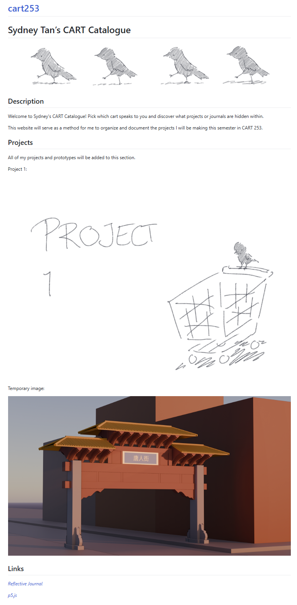
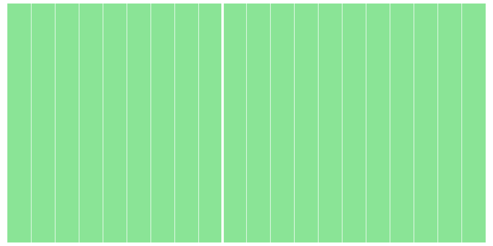
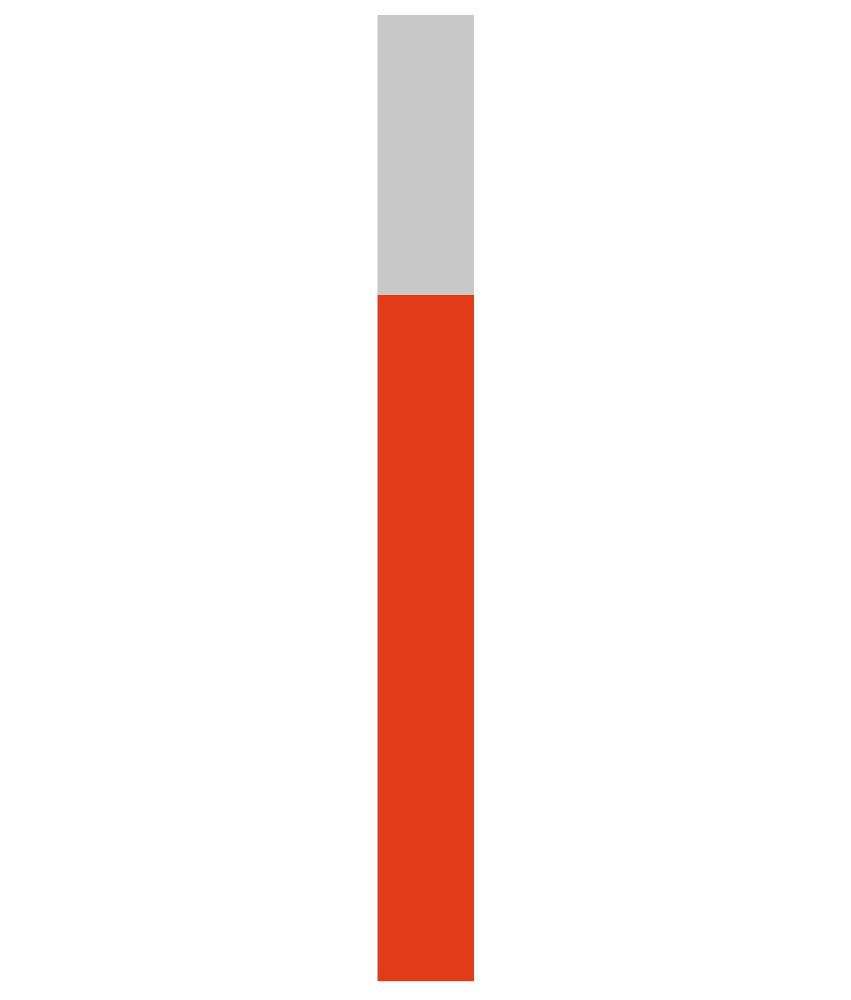
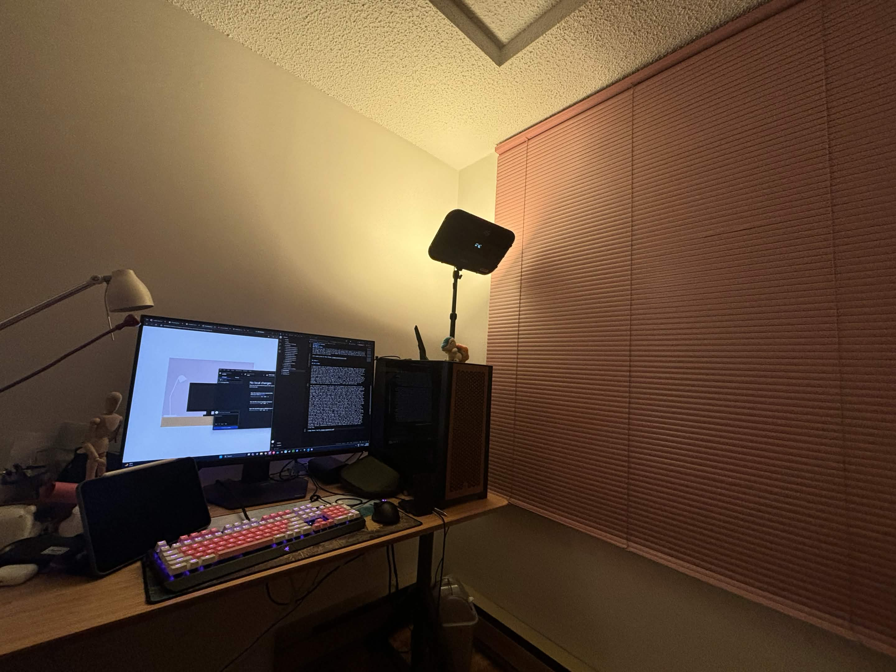
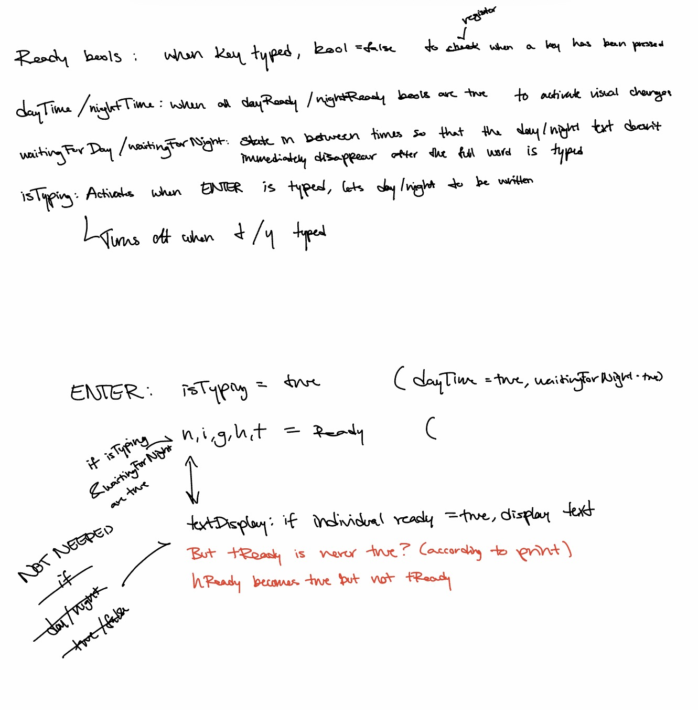
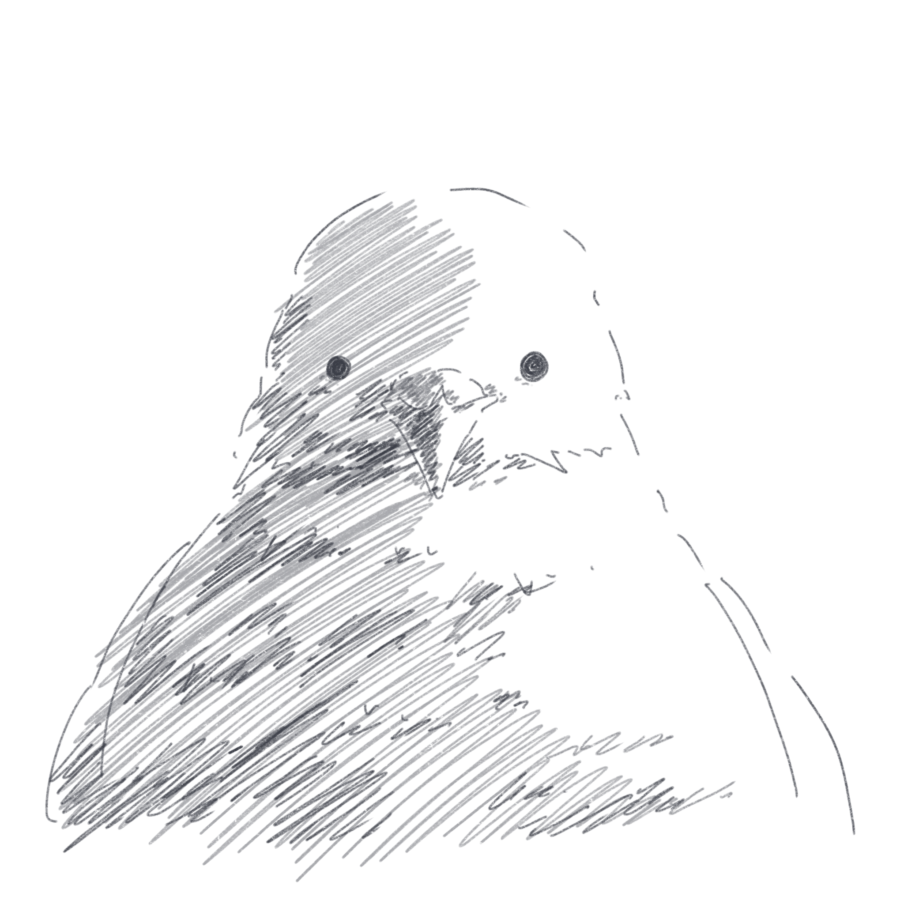

# Reflective Journal

## Entry 1

### Sept 13 2026

This is my first time using both GitHub and Markdown. Honestly, it took a while for me to understand how both worked (mostly the setup and all of the stuff related to which link leads to which page), but the coding part of the website was fairly familiar. I have used p5.js and I've coded 2 really simple games in Unity before so I have a decent understanding of how it works. While making the Markdown website, I had trouble finding the web version of this very journal file online. I keep forgetting how to write the URLs. I want to figure out how to change the layout of the images in the website next. For now, I made a temporary "fix" by extending the image, but for project documentation I'd prefer being able to add text that go around the images. For now, all of them take the entire width of the page which I don't really like. When making a new temporary page for project 1, I forgot to add .md at the end of the file name and that caused a bit of a headache. I do really enjoy how easy it is to work on multiple devices thanks to GitHub. I enjoy working on my own PC at home, so being able to transfer my work from one device to another through another means than Google Drive is quite nice.
My goal is to hopefully be able to work at a video game company. I still don't know what role I'd like to get in that company and I also don't know what type of game I'd like to make so right now I'd like to just experiment a bit. My hope is that throughout these years in this program, I'll be able to get a better idea of what I'd like to make and how I want my audience to feel.

## Entry 2

### Sept 15 2026

During the class challenge, me, Angy and Konstantinos made a sunset lansdcape with a crow that appears when mouse is pressed. We had used p5.js before so for the most part, this challenge was really just a review of what we had learned before. We used a for loop to create a sunset gradient and a bunch of triangles and a quad to make the mountains. The entire bird was made in a single function and is made of circles (body and eyes) triangles (eyebrows and beak), ellipses (the angry circle near the beak), and lines (feet). The bird and a caw mp3 get called when mouse is pressed. As mentioned earlier, the 3 of us already worked on p5.js before so the challenge was mostly a review of things we had done in previous semesters in Dawson IMA. Personally, I never added sounds to my p5 projects so I did learn how to do that today. In some ways it is quite similar to how images are added to the README.md page so it wasn't complicated. The most challenging parts were the GiHub side of things. We had trouble getting the code to preview on the web and we also had trouble opening the project page.

For the most part, the prototyping instructions assignment was more of a review of codes I've used before. The first prototype I made was the one with the frog. Cuz I like frogs. This one's name is Johnny the Frog. It wasn't challenging to make, just time consuming. I don't enjoy making triangles in p5. This one went very well. I didn't come across any troubles while making it. I think it'd be fun if I added a function where the frog opens its mouth and ribbits when the mouse is clicked. The second prototype is the weird shapes thing I've titled Beats because it reminds me of those music visuals that react to sound. Except this one changes depending on mouse movement. I wanted to make something that was a bit more visually appealing for this one. This one was also mostly just a review of codes I've learnt before. The hard part of this prototype was making the file itself. I made this one on a separate day from the frog so I forgot how to start a file. I ended up copy pasting the frog file but that went horribly wrong and there were some issues where my computer was telling me I couldn't delete the misplaced files because I didn't have administrative permissions or something like that. In the end I just redownloaded the template file on Pippin's website and that worked great. The final prototype is a thing with black and white lines that kinda get cut at different points. For this one, I wanted to try a thing in p5.js I'd never used before. I stumbled across shearX and shearY. I wanted to test them out and ended up with this. I did a bit of experimenting with different shapes and parameters before arriving at the current final result. If I were to continue this prototype further, I'd try to include map in it to see if I can make the shear lines move in a smooth manner.

## Entry 3

### Sept 27 2026

Oh boy, this one. Once again, I've used p5.js in Dawson IMA before so I'm familiar with variables. For the challenge, Angy and I were mostly just messing around and trying to make the funniest and weirdest version of the challenge we could do. Both of us were familiar with how to complete the challenge so we divided the work in this manner: i was in charge of drawing the bird on p5.js and making sure all of its parts were connected with variables and angy was in charge of all the mouvements and variations in the variables' values. Overall, it wasn't too challenging but a lot of fun to make. 

The homework also wasn't too hard. I didn't come across any problems I couldn't fix. Once again, it was mostly just me revisiting things I've learnt before. But man did the 3rd one take a lot of time. The first one is really realy simple. Just a bunch of leaves who's rgb values change when the mouse moves. I was going to add more leaves but I didn't wanna deal with rotate or have to manually change all of the leaf orientations so I stopped it there. The 2nd one I've made a similar [project on p5.js back in Dawson](https://editor.p5js.org/tinglt/sketches/UUkKMK2hf). It was an in class assignment. I wanted to make something similar but on a larger scale. So I made bubbles that floated up at different speeds. There's also a timer so that a few bubbles can spawn in a bit later than the initial few. There are 6 different bubbles that have different values. Their initial colours and positions are randomized. Some of them change colour as they go up as well. Their alphas also decrease as they go up. I tried turning the bg off for this project, the result is pretty cool too. I should've probably changed the canvas format to be shorter but wider too. Finally, the 3rd one. This one wasn't exactly challenging in terms of skill but it was definitely challenging mentally. The problems I came across where easy to fix but there were so many variables with different names that took so long to write I was about to lose my mind. There were a bunch of times where something didn't work how I wanted it to and then it suddenly hit me why that was the case. A kind of "of course that wouldn't work" moment. I do like how it turned out though. Now that I finished it and have time to think of how to improve it, I think it'd be fun to make it so that the last lines change the line colours. But that'd be so much work and I'm pretty tired so I won't do that.

## Entry 4

## Oct 5 2026

I think we were a bit too ambitious during this class' in-class challenge. Angy and I came across a multitude of problems while working on this one. Most notably, the target's dotted circle did not want to draw properly. We thought the best way to make a dotted line was to make a for loop, but for some reason the for loop didn't want to draw itself in a regular manner. It split our circle into 4 parts and it was drawing the lines gradually. By that, I mean the first 3 lines in the quarter of the circle were really close to each other while the following were slowly distancing themselves more and more. We couldn't find a way to fix it so we went to ask Michael for help ...but he also couldn't figure it out ._. In the end, Angy pressed random numbers and it somehow worked so problem solved but problem also not solved. After that, we had issues with our target's detection circle and drawn circle not lining up ...and then our crow caw sound wasn't playing... We had to ask Pippin for help. On the bright side, the conditionals part of the assignment was easy to understand. Everything else... I don't get what went wrong.

For the homework assignments, I ran into a lot of problems in my first prototype so I'll talk about that one first. My first prototype is supposed to be like the dinosaur game that would show up when there was no internet connection. I also took inspiration from Geometry Dash. Making the obstacle move was really easy. I ran into some problems because I forgot to make my speed modifier negative and I was breaking my head trying to figure out why my speed was getting slower the higher the number went. Problem solved, but then I couldn't figure out how to make a smooth jump movement for the player cube. I tried a couple of things, even asked ChatGPT to detail my code... but I still couldn't really figure it out. I got close to a good movement, but right now the cube suddenly starts slowing down when it gets close to the ground. I genuinely don't know why. Once again, the conditionals part of this project went well. For the 2nd prototype, I made a project where some circles would change colour when they overlapped. My main goal with this one was to understand how overlap worked a bit better. I tried adding borders to the circles but that didn't really work the way I wanted it to so I abandoned the idea. I don't have much to say about this one. I did want to make 6 circles at the start of the prototype, but then I realized I probably wouldn't learn much from copy pasting my existing code an extra 6 times. It was also going to be really time consuming so I abandoned that idea too. My 3rd prototype was by far the most enjoyable to make. I wanted to make a keyboard smashing project where the more keys you pressed, the higher the bar would go up ...but I finished that in like 5 minutes... So I decided to elaborate on it a bit more by adding a screen with messages that would appear once the bar was at its max. Ironically, making the messages that were supposed to tell you to chill out was annoying me more than making the rage meter itself. I have a bit of prior experience with making message texts before as I made an air hockey project in p5.js back in Dawson that had a decent amount of score screens. The logic behind them was clear to me. I made a page system that would change text depending on how many times an invisible circle reaches the end of the screen. The amount of times it would reach the end would determine the page that would be displayed. After the pages reach 20, the screen disappears and then rage meter comes back. The cycle can then be continued. Overall, conditionals are something I'm fairly familiar with and I do quite enjoy using them.

## Entry 5

## Oct 20 2026

The class challenge for this week was honestly very easy. Both Angy and I are fairly familiar with events so it didn't take too long for us to finish what we had to do in the challenge. We did however run into more sound problems. 

I had a bit of trouble coming up with inspiration for what to make for my homework this week so I took inspiration from my daily life. My room was my biggest inspiration. For my first prototype, I made a typing project that detects when "night" and "day" are written. The background changes according to the word typed. Before even starting the project, I really wanted to make a sort of typing detector where writing specific words would make something happen. I just to happened to have finished Persona 3 Reload the week before starting the project. The time of day is an important element in the game as your days are limited and certain actions are only permitted during certain times of the day (early morning, morning, after school, evening, and such). The result of that is what you see. I took a few days of break after I started this project so I started forgetting what my bools did. So much so that I considered remaking the entire project from scrap. I ended up having to write down what all of my bools did and what I wanted them to do. I had issues where the t and d werent displaying properly. The t was because the dayTime and nightTime states where activated too quickly and didnt give the t enough time to stay present. I had to create the isTyping and waitingForNight/waitingForDay bools to prevent the t from disappearing instantly. As to why the d kept disappearing... at the point, the "night" worked perfectly and my "day" had the exact same code. Turns out I accidentally wrote the y of the textDisplay for d 400 y lower than it was supposed to be ._. The rest of the process went smoothly. The 2nd and 3rd prototypes are based off of my own room. The curtains were suggested by my mom. When the mouse wheel is scrolled, the curtains go up and down. No issues while making that one. It was however my first time using mouseWheel() so now I know how it works. The final prototype is my desk setup. I ran out of ideas and thought, since I was already making my curtains, might as well make the thing I stare at most of the time. As mentioned prior, I didn't really know what to make this week. Making something I'm so familiar with was honestly strangely inspiring. My idea for how I wanted it to look was very clear from the start. I guess this week I wanted to make something that felt more like myself.

## Entry 6

## Oct 27 2026

This week's class challenge was fairly easy to make, not much to comment on.

For the assignments, I once again ran out of ideas. I knew I wanted to rework one of my previous prototypes so I decided to go with the bubbles one since I wanted to change the ratio of that canvas either way. By using function parameters, I was able to reduce my code's length from 282 lines to 170 lines. The bubbles' variables are now a lot more randomized than before. I could make them a lot more predetermined (mostly in colour), but I don't mind the unpredictability that comes with these new changes so I decided to keep them. Parameters definitely made the duplication of bubbles functions a lot easier. I feel like adding arrays to this project would make it even more interesting rather than just the 6 looping bubbles. The second prototype is inspired by agar.io. I wanted to make something where the changes in function parameter were more visible I guess? With this, I wanted to make a fairly repetitive object that had visible variations thanks to parameters. In this one, the "food" orbs all have the same up and down motion but have different colours and more importantly, different sizes. The different sizes are important because that's what changes in the overlap. I am then able to detect what size the target (the orb that was eaten) is and make an if statement so that each orb increases the size of the player depending on its own size. In the middle of making this prototype, my idea changed and I wanted to make a small game where you feed a goldfish. The player would be able to give the fish food when clicking on the mouse. The fish would swim a bit randomly around its tank. But then I realized the food would be a lot easier to code if it was made in an array. I honestly don't remember much about arrays from my time in Dawson, so I decided to wait until next week to bring this idea to life since that will be our topic. The final prototype for this week is the result of lacking ideas and returning to the one thing I like to draw when out of ideas. Welcome to the Hotel of Crows but it isn't really a hotel. I was breaking my mind a bit too much while wondering what cool stuff I could make with function parameters but I couldn't think of anything. I started thinking about buttons, then about doors (i played too much persona 3, there's a cool door animation in that game when the player enters what's called the "Velvet Room". it's like a corridor of doors that leads to the door the protagonist enters bu there's no corridor or doors. it's just bright rectangle that look like they could be doors). I then thought of a hotel hallway and doors that led to small rooms. And then I thought of crows. I realized there was a significant lack of crows in my individual projects outside of the class challenges with Angy despite my CART website having crows everywhere. I don't have much to say about the coding itself, it wasn't too hard. Most of the issues that came up were small things that had to do with what each bool does but they were solved relatively quickly. What I learned from this week's assignment is that 1. I need to find better ways to come up with ideas and 2. man i need to relearn how arrays work.

