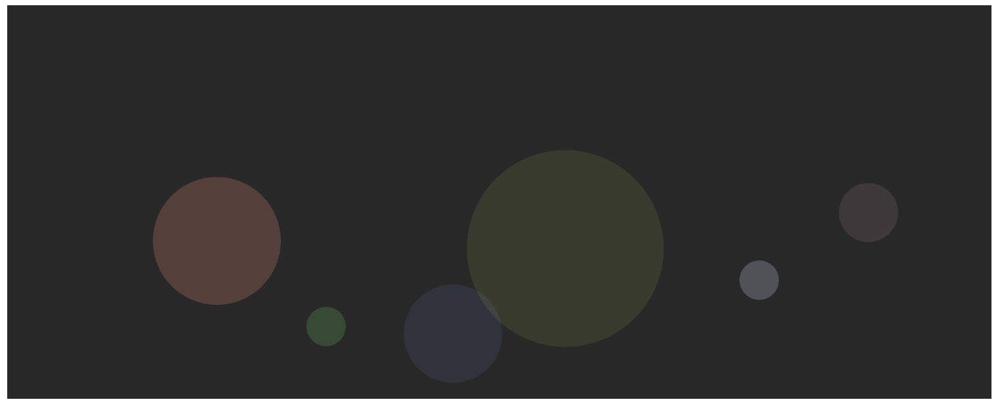
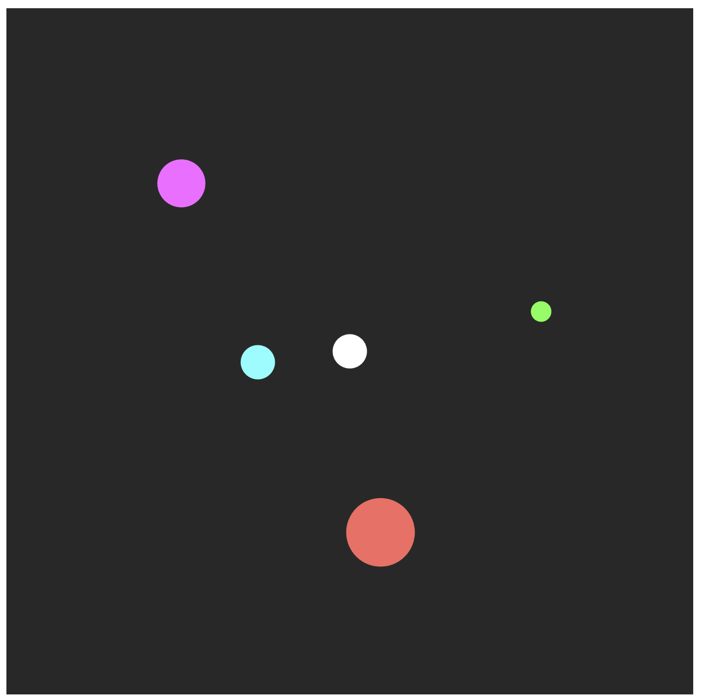
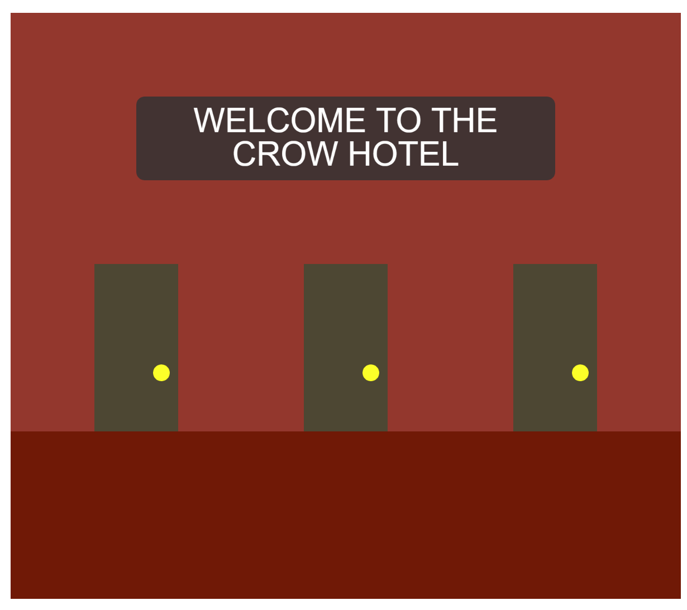

# Prototyping: Functions

Sydney Tan

[View this project online](https://sydneylttan-dot.github.io/cart253/prototypes/prototyping-functions)

## Journal Entry: 

[Reflective Journal: Entry #6](https://sydneylttan-dot.github.io/cart253/journal#entry-6)

## Description

Assignment 6 of CART 253. Here are my 3 prototypes for the prototyping functions assignment.

PROTOTYPE 1: Better Bubbles: 
[View code](https://github.com/sydneylttan-dot/cart253/blob/main/prototypes/prototyping-functions/prototyping-functions-1/js/script.js)

PROTOTYPE 2: Food Chain: 
[View code](https://github.com/sydneylttan-dot/cart253/blob/main/prototypes/prototyping-functions/prototyping-functions-2/js/script.js)

PROTOTYPE 3: Welcome to the Crow Hotel: 
[View code](https://github.com/sydneylttan-dot/cart253/blob/main/prototypes/prototyping-functions/prototyping-functions-3/js/script.js)

## Attribution

> - This project uses [p5.js](https://p5js.org).

## License

> This project is licensed under a Creative Commons Attribution ([CC BY 4.0](https://creativecommons.org/licenses/by/4.0/deed.en)) license with the exception of libraries and other components with their own licenses.
